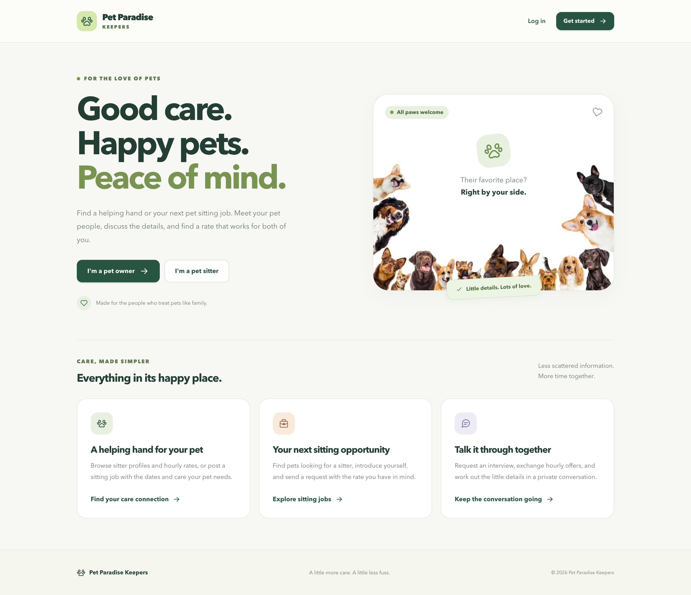

# Pet Paradise Keepers

Pet Paradise Keepers is an Express application for managing pet owner and sitter profiles. Owners can keep their pets' photos and medical history together; sitters can maintain their biography, experience, and hourly rate.

## Key Features

- **Authentication:** Register as an owner or sitter, log in with a username or email, and log out.
- **Pet Management:** Owners can add, view, edit, and delete their own pets, including photos and medical history.
- **Profile Management:** Both roles can update their names, email, password, and profile photo. Sitters can also update their biography, experience, and hourly rate.
- **Sitting Jobs:** Owners can publish jobs for their own pets with care details, location, Eastern-time dates, and an offered hourly rate. Sitters can browse open jobs and apply.
- **Sitter Discovery:** Owners can browse sitter profiles, search their experience, filter by hourly rate, and request an interview for a pet.
- **Requests and Negotiation:** Both roles can propose and counter hourly offers, accept or decline the latest offer, and withdraw requests they initiated. Accepting a job closes its listing.
- **Private Messages:** Owners and sitters can start private conversations, see unread messages, browse older messages, and reply. An open thread checks for updates every five seconds without clearing drafts.
- **Account Deletion:** Remove an account and its pets, jobs, requests, and conversations, then end its session.

## Building Process

### Technology Used

This project incorporates a range of technologies, including:

- HTML
- CSS
- JavaScript
- Express.js / Node.js
- Mongoose / MongoDB

The application adheres to the MVC (Model-View-Controller) architecture, utilizing Express.js for routing and controllers, Mongoose for MongoDB object modeling, and EJS for dynamic HTML rendering.

### Approach Taken

The application uses Mongoose account, pet, job, request, conversation, and message models with role-specific controllers and EJS views. Authentication loads the current account before protected requests. Pet and job mutations are scoped to the owner, and requests and conversations are limited to their participants.

[Trello](https://trello.com/b/IwtWu45k/pet-sitting)

[Fima](https://www.figma.com/file/rjGkI8WUPvzsBHZPvxlq4V/Pet-sitting-website?type=design&node-id=0%3A1&mode=design&t=Fjgn666GW37Sc4vJ-1)

### Installation and Startup Instructions

1. Install Node.js 20 or later and run `npm ci`.
2. Copy `.env.example` to `.env` and set `MONGODB_URI` and a long, random `SESSION_SECRET`.
3. Start MongoDB locally or supply the URI of a MongoDB deployment.
4. Run `npm start` and visit `http://localhost:3000` (or the configured `PORT`).

Startup waits for MongoDB and reports missing configuration or connection failures. Set `ENABLE_LIVERELOAD=true` to enable the optional development reload server. Production installs can use `npm ci --omit=dev`; LiveReload is disabled in production.

For a separate local test database, run `npm run dev:local`. This starts MongoDB on port 27018 and the app on port 3000 (or your configured `PORT`), preserving `.env`. Test data stays in `.local/mongodb-data` between runs. Press Ctrl+C to stop both processes. The command uses `.local/mongodb/bin/mongod` when present, otherwise `mongod` from your PATH; you can also set `MONGOD_BIN` to an installed executable.

Photo uploads accept JPEG, PNG, GIF, and WebP files up to 5 MB each. Files are stored under `public/uploads`; this directory and `.env` are ignored by Git. Deployments need persistent storage for uploaded photos.

## Verification

Run `npm test` for authentication, role access, ownership, job dates, negotiation, message permissions, upload handling, and EJS rendering checks. Tests use isolated sessions and stub database operations, so they do not require MongoDB or modify your application database.

To try the marketplace locally, create an owner account and add a pet, then post a sitting job from **Sitting jobs**. In another browser session, create a sitter account and use **Find jobs** to apply. Review the request as the owner, send a counteroffer, and accept it as the sitter. Use **Messages** from either account to talk privately. Owners can also use **Find sitters** to browse rates and request an interview. Job listings share only the chosen pet's name, type, photo, and care details entered into that listing; saved private medical histories are not automatically published.

With the local MongoDB running, `npm run test:local-marketplace` exercises this workflow against real MongoDB and an isolated HTTP server. It uses and removes a temporary database on port 27018; it does not use `.env` or change your local app's accounts.

### Unsolved Problems and Future Features

- **Booking and Payments:** Calendar booking, availability management, payments, and interview scheduling are future features. Current requests record introductions and agreed hourly rates.
- **Sharing Lists:** Future updates will include functionality for owners to share their lists with other users.
- **Manual Entry:** We plan to allow users to manually add sitters or pets not listed in the database.

## Resources & References

The development of Pet Paradise Keepers changed into supported with the aid of diverse sources, which include the MongoDB and Mongoose documentation, ChatGPT, Express.Js publications, and CSS styling references from W3Schools. Community boards like Stack Overflow supplied invaluable insights for troubleshooting.

---

Pet Paradise Keepers brings pet details, sitter discovery, sitting jobs, requests, and private conversations into one place.
